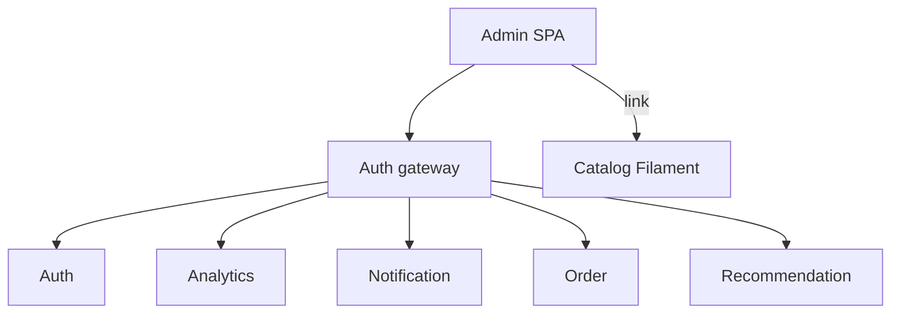
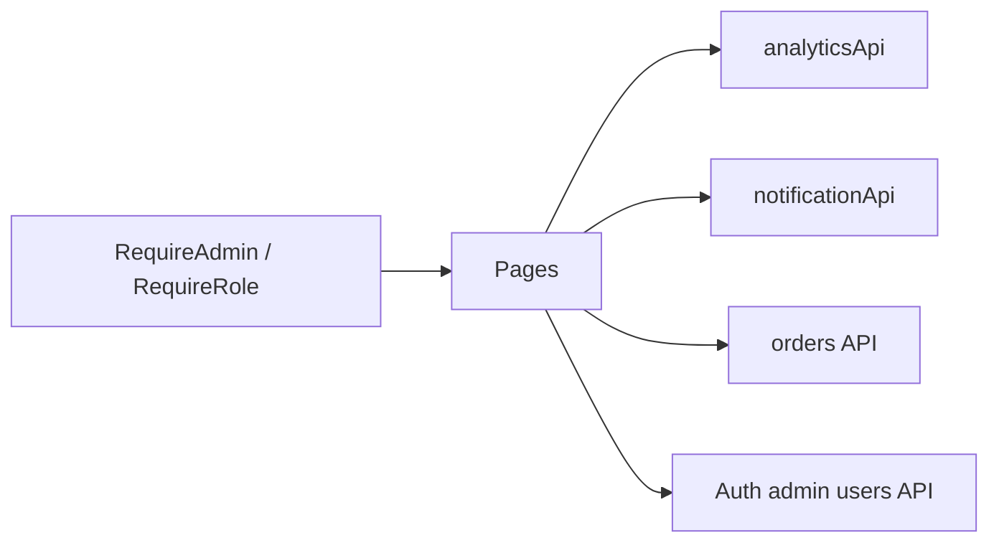
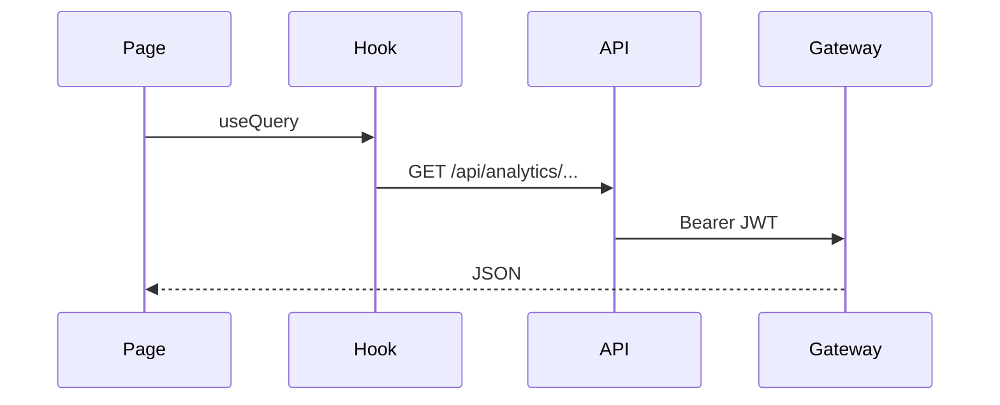

# Architecture

## Context

## Role-based UI

## Typical data flow

JWT access token is kept in memory (`src/api/http.ts`). Catalog administration opens Filament with gateway URL and optional token query parameter.
