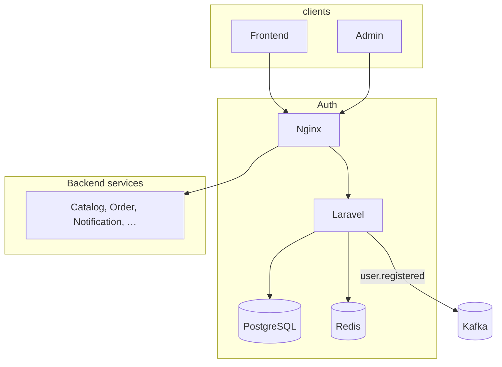
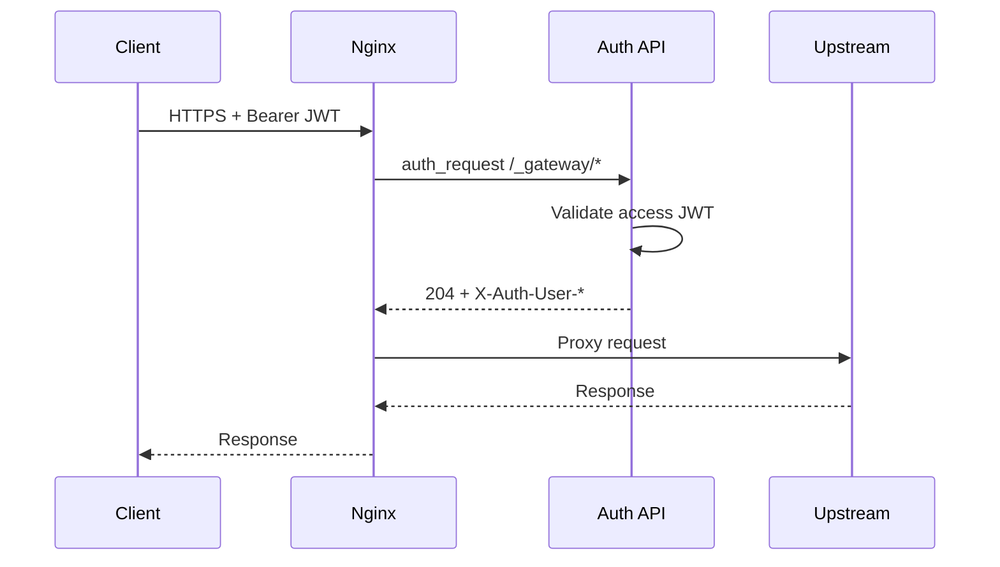
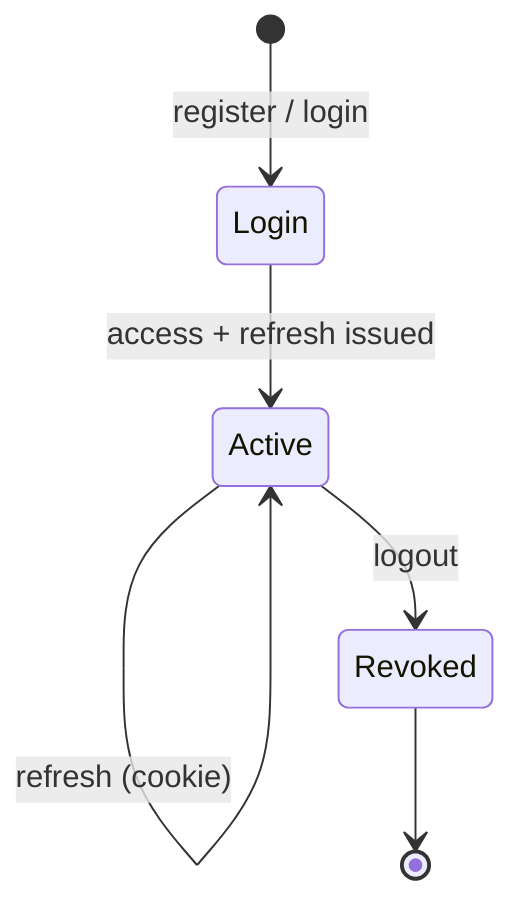
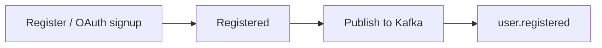
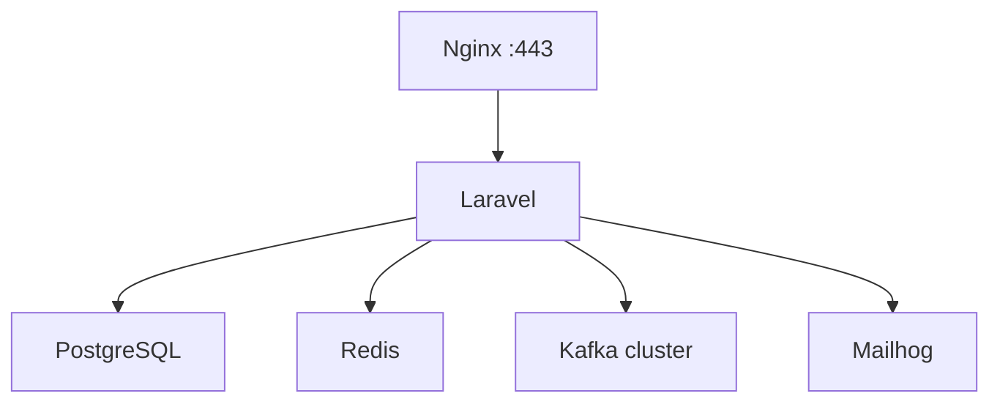

# Architecture

## Context

## Gateway request flow

| Subrequest | Allowed roles |
| --- | --- |
| `GET /_gateway/customer` | Authenticated user |
| `GET /_gateway/staff` | `admin`, `analyst` |
| `GET /_gateway/admin` | `admin` |

## Token lifecycle

- Access JWT: short TTL, sent in `Authorization` header.
- Refresh JWT: long TTL, HttpOnly cookie, Redis-backed rotation.
- Logout: blacklist access JTI, remove refresh keys from Redis.

## Registration event

Payload: [events.md](events.md).

## Runtime (Docker)

Auth connects to Kafka over `microservices-net` (`kafka:9092`).
