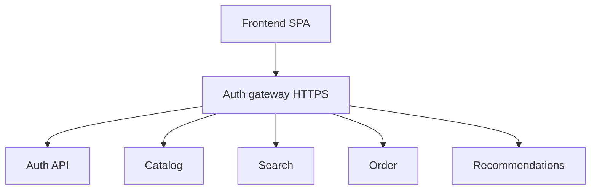
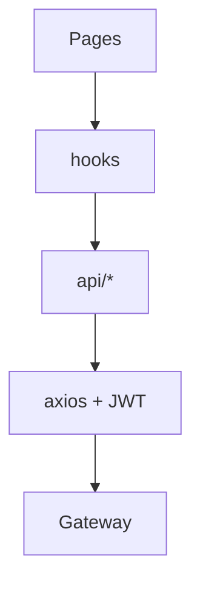
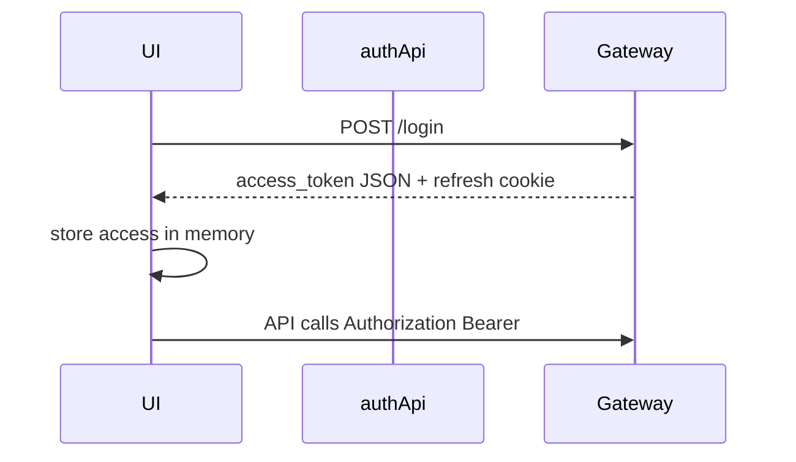

# Architecture

## Context

## Client layers

## Authentication

Access token is not stored in `localStorage`. Session restore uses `/me` and `/refresh` via `authApi`.

## Cart and orders

Cart state lives in React context (`CartContext`). Checkout and orders call Order API through the gateway (`orderApi`).
